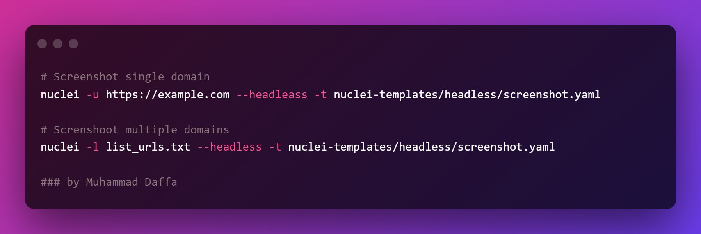

# Recon Methadology (old)

# Recon Methadology (old)

“Methodology I used once in past - Outdated info is expected”

## Subdomain Enumeration :

<details>
<summary>ASN Lookup</summary>

<dl>
<dd>

1. https://github.com/yassineaboukir/Asnlookup

2. https://bgp.he.net/

3. Amass : `amass intel -org "Netflix"`

</dd>
</dl>

</details>

<details>
<summary>Acquisitions lookup</summary>

<dl>
<dd>

https://www.crunchbase.com/organization/wework/recent_investments

<details>
<summary>others</summary>

<dl>
<dd>

1. http://tracxn.com

2. Wikipedia

3. Google Dork --> "Target Name" AND "acquired by"

</dd>
</dl>

</details>

</dd>
</dl>

</details>

<details>
<summary>https://github.com/six2dez/AnalyticsRelationships</summary>

<dl>
<dd>

<details>
<summary>Install</summary>

<dl>
<dd>

> git clone https://github.com/Josue87/AnalyticsRelationships.git  
> cd AnalyticsRelationships/Python  
> sudo pip3 install -r requirements.txt

</dd>
</dl>

</details>

<details>
<summary>Usage</summary>

<dl>
<dd>

$python3 analyticsrelationships.py -u https://www.example.com

</dd>
</dl>

</details>

</dd>
</dl>

</details>

<details>
<summary>https://github.com/projectdiscovery/subfinder</summary>

<dl>
<dd>

<details>
<summary>Install</summary>

<dl>
<dd>

$go install -v github.com/projectdiscovery/subfinder/v2/cmd/subfinder@latest

</dd>
</dl>

</details>

<details>
<summary>Usage</summary>

<dl>
<dd>

$ congifure api\_keys for scanner services providers.

$ subfinder -d domain.com - all -o /path/to/new/folder

`$ subfinder -dL domains.txt - all -oD ~/path/to/output`

</dd>
</dl>

</details>

<details>
<summary>Web-GUI version</summary>

<dl>
<dd>

https://github.com/Elsfa7-110/Subra

</dd>
</dl>

</details>

</dd>
</dl>

</details>

<details>
<summary>https://github.com/guelfoweb/knock</summary>

<dl>
<dd>

<details>
<summary>install</summary>

<dl>
<dd>

$git clone https://github.com/guelfoweb/knock.git  
$cd knock  
$pip3 install -r requirements.txt

</dd>
</dl>

</details>

<details>
<summary>Usage</summary>

<dl>
<dd>

$knockpy.py --set apikey-virustotal=APIKEY  
$python3 knockpy.py <DOMAIN> “or”

$python3 knockpy.py domain.com -o /path/to/new/folder

</dd>
</dl>

</details>

</dd>
</dl>

</details>

<details>
<summary>https://github.com/six2dez/reconftw</summary>

<dl>
<dd>

<details>
<summary>installation</summary>

<dl>
<dd>

git clone https://github.com/six2dez/reconftw  
cd reconftw/  
./install.sh

</dd>
</dl>

</details>

<details>
<summary>Usage</summary>

<dl>
<dd>

|  |  |  |
| --- | --- | --- |
| -l | Specify a list of target domains (*targets.txt*), reconFTW runs one time for each target | `./reconftw.sh -l targets.txt -r` |
| -m | For one target with multiple domains (tesla.com, teslamotors.com...) | `./reconftw.sh -m target -l domains.txt -r` |

<details>
<summary>For single target domain</summary>

<dl>
<dd>

./reconftw.sh -d target.com -r

</dd>
</dl>

</details>

</dd>
</dl>

</details>

</dd>
</dl>

</details>

<details>
<summary>https://github.com/projectdiscovery/chaos-client</summary>

<dl>
<dd>

<details>
<summary>install</summary>

<dl>
<dd>

go install -v github.com/projectdiscovery/chaos-client/cmd/chaos@latest

#setup api-key

chaos -key API\_KEY

</dd>
</dl>

</details>

<details>
<summary>Usage</summary>

<dl>
<dd>

chaos -d uber.com -o uber.txt

chaos -dL domains.txt

</dd>
</dl>

</details>

</dd>
</dl>

</details>

<details>
<summary>Assetfinder:</summary>

<dl>
<dd>

<details>
<summary>Install</summary>

<dl>
<dd>

$go get -u github.com/tomnomnom/assetfinder

</dd>
</dl>

</details>

<details>
<summary>Usage</summary>

<dl>
<dd>

$assetfinder domain.com

$ make a file manually [copy + paste]

</dd>
</dl>

</details>

</dd>
</dl>

</details>

<details>
<summary>https://github.com/pikpikcu/nuubi</summary>

<dl>
<dd>

<details>
<summary>Install</summary>

<dl>
<dd>

git clone https://github.com/pikpikcu/nuubi.git

pip install -r requirements.txt

python3 nuub.py -h

</dd>
</dl>

</details>

<details>
<summary>Usage</summary>

<dl>
<dd>

$python3 nuub.py - -s domain.com

</dd>
</dl>

</details>

</dd>
</dl>

</details>

<details>
<summary>https://github.com/gwen001/github-subdomains</summary>

<dl>
<dd>

<details>
<summary>Install</summary>

<dl>
<dd>

$ go get -u github.com/gwen001/github-subdomains

</dd>
</dl>

</details>

<details>
<summary>Usage</summary>

<dl>
<dd>

#configure github token

$ github-subdomains -d domain.com

</dd>
</dl>

</details>

</dd>
</dl>

</details>

<details>
<summary>Sublist3r</summary>

<dl>
<dd>

<details>
<summary>install</summary>

<dl>
<dd>

$ git clone https://github.com/aboul3la/Sublist3r.git

$ sudo pip install -r requirements.txt

#Dependencies:

1. $ sudo pip install requests

2. $ sudo pip install dnspython

3. $ sudo pip install argparse

</dd>
</dl>

</details>

<details>
<summary>Usage</summary>

<dl>
<dd>

$ python sublist3r.py -d example.com -o /path/to/folder/text.txt

</dd>
</dl>

</details>

</dd>
</dl>

</details>

<details>
<summary>DNSX</summary>

<dl>
<dd>

<details>
<summary>install</summary>

<dl>
<dd>

go install -v github.com/projectdiscovery/dnsx/cmd/dnsx@latest

</dd>
</dl>

</details>

<details>
<summary>Usage `Bruteforcing method`</summary>

<dl>
<dd>

`dnsx -silent -d facebook.com -w dns_worldlist.txt`

<details>
<summary>Keyword supplying</summary>

<dl>
<dd>

> **dnsx** can be used to bruteforce targeted subdomain using single or multiple keyword input, as `d` or `w` flag supports file or comma separated keyword inputs.

`dnsx -silent -d domains.txt -w jira,grafana,jenkins`

> Or run against multiple domains

`cat domains.txt | dnsx -silent -w jira,grafana,jenkins -d -`

</dd>
</dl>

</details>

</dd>
</dl>

</details>

</dd>
</dl>

</details>

<details>
<summary>Crobat</summary>

<dl>
<dd>

<details>
<summary>Install</summary>

<dl>
<dd>

$ go get github.com/cgboal/sonarsearch/cmd/crobat

</dd>
</dl>

</details>

<details>
<summary>Usage</summary>

<dl>
<dd>

$crobat -s domain.com [subdomains scan]

$ crobat -t domain [TLD Top-Level-Domain search]

</dd>
</dl>

</details>

</dd>
</dl>

</details>

<details>
<summary>crtfinder</summary>

<dl>
<dd>

<details>
<summary>Install</summary>

<dl>
<dd>

$ git clone https://github.com/eslam3kl/crtfinder.git

$ pip install -r requirments.txt

</dd>
</dl>

</details>

<details>
<summary>Usage</summary>

<dl>
<dd>

$ `python3 crtfinder.py -u dell.com | tee -a subdomains.txt`

</dd>
</dl>

</details>

</dd>
</dl>

</details>

<details>
<summary>https://github.com/darklotuskdb/sd-goo</summary>

<dl>
<dd>

<details>
<summary>Install</summary>

<dl>
<dd>

`$ git clone https://github.com/darklotuskdb/sd-goo.git && cd sd-goo && chmod +x *.sh`

</dd>
</dl>

</details>

<details>
<summary>Usage</summary>

<dl>
<dd>

`$ ./sd-goo.sh target.com`

</dd>
</dl>

</details>

</dd>
</dl>

</details>

<details>
<summary>https://github.com/edoardottt/scilla</summary>

<dl>
<dd>

<details>
<summary>Install</summary>

<dl>
<dd>

- `git clone https://github.com/edoardottt/scilla.git`

- `cd scilla`

- `go get`

- `make linux` (to install)

- Edit the `~/.config/scilla/keys.yaml` file if you want to use api keys

- `make unlinux` (to uninstall)

</dd>
</dl>

</details>

<details>
<summary>Usage</summary>

<dl>
<dd>

- DNS enumeration:
    `scilla dns -target target.domain`
    `scilla dns -oj output -target target.domain`
    `scilla dns -oh output -target target.domain`
    `scilla dns -ot output -target target.domain`
    `scilla dns -plain -target target.domain`

- Subdomains enumeration:
    `scilla subdomain -target target.domain`
    `scilla subdomain -w wordlist.txt -target target.domain`
    `scilla subdomain -oj output -target target.domain`
    `scilla subdomain -oh output -target target.domain`
    `scilla subdomain -ot output -target target.domain`
    `scilla subdomain -i 400 -target target.domain`
    `scilla subdomain -i 4** -target target.domain`
    `scilla subdomain -c -target target.domain`
    `scilla subdomain -db -target target.domain`
    `scilla subdomain -plain -target target.domain`
    `scilla subdomain -db -no-check -target target.domain`
    `scilla subdomain -db -vt -target target.domain`
    `scilla subdomain -ua "CustomUA" -target target.domain`
    `scilla subdomain -rua -target target.domain`

</dd>
</dl>

</details>

</dd>
</dl>

</details>

<details>
<summary>https://github.com/skynet0x01/tugarecon</summary>

<dl>
<dd>

<details>
<summary>Install</summary>

<dl>
<dd>

- git clone https://github.com/skynet0x01/tugarecon.git

- pip install -r requirements.txt

</dd>
</dl>

</details>

<details>
<summary>Usage</summary>

<dl>
<dd>

```
    python3 tugarecon.py -d google.com
    python3 tugarecon.py -d google.com --savemap
    python3 tugarecon.py -d google.com --bruteforce
    python3 tugarecon.py -d google.com --bruteforce --full
    python3 tugarecon.py -d google.com -b --full
    python3 tugarecon.py -r
```

</dd>
</dl>

</details>

</dd>
</dl>

</details>

<details>
<summary>https://github.com/screetsec/Sudomy</summary>

<dl>
<dd>

<details>
<summary>Install</summary>

<dl>
<dd>

git clone --recursive https://github.com/screetsec/Sudomy.git

$ python3 -m pip install -r requirements.txt

```
apt-get update
apt-get install jq nmap phantomjs npm chromium parallel
npm i -g wappalyzer wscat
```

</dd>
</dl>

</details>

<details>
<summary>Setup api\_keys</summary>


</details>

<details>
<summary>Usage</summary>

<dl>
<dd>

To use all 22 Sources and Probe for working http or https servers (Validations):

`$ sudomy -d hackerone.com`

To use one or more source:

`$ sudomy -s shodan,dnsdumpster,webarchive -d hackerone.com`

To use all Sources Without Validations:

`$ sudomy -d hackerone.com --no-probe`

To use one or more plugins:

`$ sudomy -pS -sC -sS -d hackerone.com`

To use all plugins: testing host status, http/https status code, subdomain takeover and screenshots.

Nmap,Gobuster,wappalyzer and wscat Not Included.

`$ sudomy -d hackerone.com --all`

To gnereate network graph visualization subdomain & virtualhosts

`$ sudomy -d hackerone.com -rS --graph`

To create report in HTML Format

```
$ sudomy -d hackerone.com --html --all
```

</dd>
</dl>

</details>

</dd>
</dl>

</details>

<details>
<summary>https://github.com/hakluke/haktrails</summary>

<dl>
<dd>

<details>
<summary>Installation</summary>

<dl>
<dd>

`go install -v github.com/hakluke/haktrails@latest`

</dd>
</dl>

</details>

<details>
<summary>Usage</summary>

<dl>
<dd>

$ setup api\_key

$ cat domains.txt | haktrails subdomains

</dd>
</dl>

</details>

</dd>
</dl>

</details>

<details>
<summary>https://github.com/nsonaniya2010/SubDomainizer</summary>

<dl>
<dd>

<details>
<summary>Install</summary>

<dl>
<dd>

`git clone https://github.com/nsonaniya2010/SubDomainizer.git`

`cd SubDomainizer`

`pip3 install -r requirements.txt`

</dd>
</dl>

</details>

<details>
<summary>Usage</summary>

<dl>
<dd>

- To list help about the tool:

`python3 SubDomainizer.py -h`

- To find subdomains, s3 buckets, and cloudfront URL's for given single URL:

`python3 SubDomainizer.py -u http://www.example.com`

- To find subdomains from given list of URL (file given):

`python3 SubDomainizer.py -l list.txt`

- To save the results in (output.txt) file:

`python3 SubDomainizer.py -u https://www.example.com -o output.txt`

- To give cookies:

`python3 SubDomainizer.py -u https://www.example.com -c "test=1; test=2"`

- To scan via github:

`python3 SubDomainizer.py -u https://www.example.com -o output.txt -gt <github_token> -g`

- No SSL Certificate Verification:

`python3 SubDomainizer.py -u https://www.example.com -o output.txt -gt <github_token> -g -k`

- Folder Scanning:

`python3 SubDomainizer.py -f /path/to/root/folder/having/files/and/folders/ -d example.com -gt <github_token> -g -k`

- Subject Alternative Names:

`python3 SubDomainizer.py -u https://www.example -san all`

- Saving secrets to a file scan found in github:

`python3 SubDomainizer.py -u https://www.example.com -o output.txt -gt <github_token> -g -gop filename_to_save`

</dd>
</dl>

</details>

</dd>
</dl>

</details>

<details>
<summary>https://github.com/0xbharath/censys-enumeration</summary>

<dl>
<dd>

<details>
<summary>Install</summary>

<dl>
<dd>

$ git clone git@github.com:yamakira/censys-enumeration.git

$ pip install -r requirements.txt

</dd>
</dl>

</details>

<details>
<summary>Usage</summary>

<dl>
<dd>

1. Get Censys API ID and Censys API secret by creating a account on `https://censys.io`

2. Add Censys API ID and Censys API secret as `CENSYS_API_ID` & `CENSYS_API_SECRET` respectively to the OS environment variables. On Linux you can use a command similar to following to do this

$ export CENSYS\_API\_SECRET="iySd1n0l2JLnHTMisbFHzxClFuE0”

$ python censys\_enumeration.py --verbose --outfile results.json domains.txt

<details>
<summary>Usage from web interface</summary>

<dl>
<dd>

services.tls.certificates.leaf\_data.names:domain.com

</dd>
</dl>

</details>

</dd>
</dl>

</details>

<details>
<summary>See also</summary>

<dl>
<dd>

$ censys search http://hackerone.com

$ censys search http://hackerone.com | grep “ip” | egrep -v “description” | cut -d “:” -f2 | tr -d \”\, | httpx

</dd>
</dl>

</details>

</dd>
</dl>

</details>

<details>
<summary>Amass</summary>

<dl>
<dd>

<details>
<summary>install</summary>

<dl>
<dd>

$go install -v github.com/OWASP/Amass/v3/...@master

</dd>
</dl>

</details>

<details>
<summary>Usage</summary>

<dl>
<dd>

1. amass enum -passive -df scope.txt | anew subs.txt

2. cat scope.txt | while read line ; do amass enum -passive -d $line | anew subs.txt ; done

</dd>
</dl>

</details>

<details>
<summary>Unlocking its full potential</summary>

<dl>
<dd>

https://twitter.com/ReconOne_bk/status/1563541857237438464?s=20&t=PrKzzJkeYEbJcvF_LRjI7w

</dd>
</dl>

</details>

<details>
<summary>Subs enumeration using ASN</summary>

<dl>
<dd>

amass intel -org yahoo -max-dns-queries 2500 | awk -F, '{print $1}' ORS=',' | sed 's/,$//' | xargs -P3 -I@ -d ',' amass intel -asn @ -max-dns-queries 2500

</dd>
</dl>

</details>

https://blog.intigriti.com/2021/06/08/hacker-tools-amass-hunting-for-subdomains/?cn-reloaded=1

https://www.bugcrowd.com/resources/webinars/owasp-amass-discovering-internet-exposure/

</dd>
</dl>

</details>

<details>
<summary>Curl</summary>

<dl>
<dd>

<details>
<summary>WaybackURLS</summary>

<dl>
<dd>

<details>
<summary>Find subdomains from waybackurl</summary>

<dl>
<dd>

cat wayback.txt | unfurl -u format %d | sort -u --version-sort

OR

cat wayback.txt | awk -F"/" '{print $3}' | sort -u --version-sort

</dd>
</dl>

</details>

$ echo domain.com | waybackurls | unfurl -u domains

</dd>
</dl>

</details>

<details>
<summary>Gau</summary>

<dl>
<dd>

gau –subs domain.com | unfurl -u domains

</dd>
</dl>

</details>

<details>
<summary>(*Here’s a handy command to extract URLs from junk / assorted data.)*</summary>

<dl>
<dd>

cat file | grep -Eo "(http|https)://[a-zA-Z0-9./?=\_-]*"*

e.g, $curl http://host.xx/file.js | grep -Eo "(http|https)://[a-zA-Z0-9./?=\_-]*"*

</dd>
</dl>

</details>

1. curl -s "https://crt.sh/?q=%25.target.tld&output=json" | jq -r '.[].name\_value' | sed 's/\\*\.//g' | sort -u

2. curl -s "https://jldc.me/anubis/subdomains/sony.com…  
   " | grep -Po "((http|https):\/\/)?(([\w.-]\*)\.([\w]\*)\.([A-z]))\w+" | httpx -silent -threads 300 | anew

3. curl -s "https://jldc.me/anubis/subdomains/att.com" | grep -Po "((http|https):\/\/)?(([\w.-]\*)\.([\w]\*)\.([A-z]))\w+" | anew | sort -u

4. curl -s "https://riddler.io/search/exportcsv?q=pld:domain.com" | grep -Po "(([\w.-]*)\.([\w]*)\.([A-z]))\w+" | sort -u | tee subs.txt

5. curl "https://subbuster.cyberxplore.com/api/find?domain=domain.tld" -s | grep -Po "(([\w.-]*)\.([\w]*)\.([A-z]))\w+"

6. curl -s "http://web.archive.org/cdx/search/cdx?url=\*.target.com/\*&output=text&fl=original&collapse=urlkey" | sed -e 's\_https\*://\_\_' -e "s/\/.\*//" | sort -u

2. curl -s https://certspotter.com/api/v0/certs\?domain\=$1 | jq '.[].dns\_names[]' | sed 's/\"//g' | sed 's/\\*\.//g' | sort -u > hosts-certspotter.txtclea

3. curl -s "https://certspotter.com/api/v1/issuances?domain=domain.com&include_subdomains=true&expand=dns_names" | jq .[].dns\_names | tr -d '[]"\n ' | tr ',' '\n'

9. curl -s "https://certspotter.com/api/v1/issuances?domain=target.com&include_subdomains=true&expand=dns_names" | jq .[].dns\_names | grep -Po "(([\w.-]*)\.([\w]*)\.([A-z]))\w+" | sort -u

10. for i in `cat scopedomains`; do curl -s -X POST https://api.mnemonic.no/pdns/v3/search  
     -H 'Content-Type: application/json' --data "{\"query\":\"$i\"}" | jq . | egrep "query" | awk -F: '{print $2 }' | cut -d'"' -f2 | anew last ;done

11. *curl -k -s**https://sonar.omnisint.io/subdomains/tesla.com**| jq -r ‘.[]’ | sort -u*

12. for ((i=1;i<=1000;i++)); do curl -i -k -s -L -X POST "https://dnsscan.cn/dns.html?keywords=yahoo.com&page=…  
    ${i}" -d "ecmsfrom=&show=&num=&classid=0&keywords=http://yahoo.com  
    " | grep -oE "[a-zA-Z0-9.\_-]+\.yahoo.com" | sort -u ; done

13. echo -n "Domain: ";read domain;curl -s http://dns.bufferover.run/dns?q=.$domain  
     | egrep "\"[1-9|a-z]" | sed "s/\s\*//g" | sed "s/\"//g" | cut -d"," -f2

14. curl -s https://dns.bufferover.run/dns?q=.target.com | jq -r .FDNS\_A[] | cut -d',' -f2 | sort -u | tee subs.txt

15. curl -s https://dns.bufferover.run/dns?q=.sony.com  
     |jq -r .FDNS\_A[] | sed -s 's/,/\n/g' | httpx -silent | anew

then run : sed 's/$/.<domain>/' subdomains-top1mil-20000.txt > hosts-wordlist.txt

1. Finally combine all above in one file:

cat hosts-amass.txt hosts-crtsh.txt hosts-certspotter.txt hosts-wordlist.txt | sort -u > massdns.out

</dd>
</dl>

</details>

<details>
<summary>URLs</summary>

<dl>
<dd>

<details>
<summary>cert\_sh</summary>

<dl>
<dd>

On the first cmd we convert the company name to trade name.

Facebook -> Meta Inc

crt.sh : Trade Name to subdomains   
  
- Replace [trade]  
$curl -s "[https://crt.sh/?O=%.[trade]&output=json](https://t.co/OK1vesgxrB)" | jq -r '.[].common\_name' | sed 's/\\*\.//g' | sort -u  
  
Example: google  
curl -s "https://crt.sh/?O=%.google+inc&output=json" | jq -r '.[].common\_name' | sed 's/\\*\.//g' | sort -u

</dd>
</dl>

</details>

<details>
<summary>Historical DNS dataset</summary>

<dl>
<dd>

https://openintel.nl/

</dd>
</dl>

</details>

<details>
<summary>Thirdparties</summary>

<dl>
<dd>

1. https://threatcrowd.org/searchApi/v2/domain/report/?domain=domain.com

2. https://dns.bufferover.run/dns?q=.domain.com

3. https://api.hackertarget.com/hostsearch/?q=domain.com

4. https://phpinfo.me/domain/

5. https://developers.facebook.com/

6. https://suip.biz/?act=subfinder

7. https://dnsdumpster.com/

8. https://rapiddns.io/

9. https://beta.shodan.io/domain/company.com

</dd>
</dl>

</details>

</dd>
</dl>

</details>

<details>
<summary>Uncover `adding pending`</summary>

<dl>
<dd>

<details>
<summary>Use with nuclei</summary>

<dl>
<dd>

uncover -q 'org:"Example Inc."' | httpx | nuclei

</dd>
</dl>

</details>

<details>
<summary>Usage</summary>

<dl>
<dd>

https://twitter.com/ReconOne_bk/status/1569266564817424384?s=20&t=PrKzzJkeYEbJcvF_LRjI7w

</dd>
</dl>

</details>

</dd>
</dl>

</details>

<details>
<summary>https://github.com/imhunterand/subton</summary>

<dl>
<dd>

<details>
<summary>Install</summary>

<dl>
<dd>

git clone https://github.com/imhunterand/subton.git

cd subton

sudo python3 subton.py

</dd>
</dl>

</details>

<details>
<summary>Usage</summary>

<dl>
<dd>

sudo python3 subton.py

</dd>
</dl>

</details>

</dd>
</dl>

</details>

<details>
<summary>https://github.com/0xbharath/domains-from-csp</summary>

<dl>
<dd>

<details>
<summary>Install</summary>

<dl>
<dd>

$ git clone git@github.com:yamakira/censys-enumeration.git

$ pipenv install

</dd>
</dl>

</details>

<details>
<summary>Usage</summary>

<dl>
<dd>

$ python csp\_parser.py target\_url

</dd>
</dl>

</details>

</dd>
</dl>

</details>

---

> `Bruteforcing Methods` :

<details>
<summary>Subdomain Brute-forcing</summary>

<dl>
<dd>

<details>
<summary>Best wordlist:</summary>

<dl>
<dd>

`#https://gist.github.com/jhaddix/86a06c5dc309d08580a018c66354a056`

#https://github.com/assetnote/commonspeak2  
#https://github.com/assetnote/commonspeak2-wordlists

#https://github.com/danielmiessler/SecLists/blob/master/Discovery/DNS/subdomains-top1million-20000.txt

<details>
<summary>Methods (do with all wordlists)</summary>

<dl>
<dd>

1. `dnsrecon -d paypal.com -D all.txt/commonspeak -t brt`

2. #Fastest is Probably SubBrute.py  
   python $Tools/subbrute/subbrute.py paypal.com paypal.co.uk -t all.txt/commonspeak.txt

3. #Final method is using GoBuster which is also v fast  
   gobuster dns -d paypal.com -w all.txt/commonspeak.txt

</dd>
</dl>

</details>

</dd>
</dl>

</details>

<details>
<summary>Brute-force subs with Fuff</summary>

<dl>
<dd>

ffuf -u https://FUZZ.rootdomain.com -w jhaddixall.txt -v | grep "| URL |" | awk '{print $4}'

ffuf -c -u target.com -H "Host: FUZZ" -w wordlist.txt

</dd>
</dl>

</details>

<details>
<summary>Brute-Forcing subs with massDNS</summary>

<dl>
<dd>

1. $ ./scripts/subbrute.py lists/names.txt example.com | ./bin/massdns -r lists/resolvers.txt -t A -o S -w results.txt

2. $ ./scripts/ct.py example.com | ./bin/massdns -r lists/resolvers.txt -t A -o S -w results.txt

</dd>
</dl>

</details>

</dd>
</dl>

</details>

<details>
<summary>PureDNS</summary>

<dl>
<dd>

<details>
<summary>install</summary>

<dl>
<dd>

GO111MODULE=on go get github.com/d3mondev/puredns/v2

or

go install github.com/d3mondev/puredns/v2@latest

</dd>
</dl>

</details>

<details>
<summary>Usage</summary>

<dl>
<dd>

puredns bruteforce all.txt domain.com

</dd>
</dl>

</details>

</dd>
</dl>

</details>

<details>
<summary>https://github.com/resyncgg/ripgen</summary>

<dl>
<dd>

<details>
<summary>Usage</summary>

<dl>
<dd>

ripgen -d subdomains.txt -w ~/Tools/permutations list.txt | sort -u > ripgen.output

</dd>
</dl>

</details>

</dd>
</dl>

</details>

<details>
<summary>https://github.com/infosec-au/altdns</summary>

<dl>
<dd>

<details>
<summary>Install</summary>

<dl>
<dd>

$ git clone https://github.com/infosec-au/altdns.git

$ `pip3 install -r requirements.txt`

$ pip3 install py-altdns==1.0.2

</dd>
</dl>

</details>

<details>
<summary>Usage</summary>

<dl>
<dd>

$python3 altdns -i subdomains.txt -o data\_output -w words.txt -r -s results\_output.txt

</dd>
</dl>

</details>

</dd>
</dl>

</details>

<details>
<summary>https://github.com/Josue87/gotator</summary>

<dl>
<dd>

<details>
<summary>Usage</summary>

<dl>
<dd>

1. gotator -silent -numbers 10 -adv -prefixes -sub subdomains.txt -md -perm ~/Tools/permutations list.txt -mindup | sort -u > gotator.output

</dd>
</dl>

</details>

</dd>
</dl>

</details>

---

### **Find admin panels**

<details>
<summary>command</summary>

<dl>
<dd>

1. cat domains\_list.txt | httpx -ports 80,443,8080,8443 -path /admin -mr "admin”

2. cat domains\_list.txt | httpx -ports 80,443,8080,8443 -paths "wordlist.txt" -mr "password”

<details>
<summary>wordlist.txt :</summary>

<dl>
<dd>

https://github.com/the-robot/admin-finder/blob/master/wordlist.txt

</dd>
</dl>

</details>

</dd>
</dl>

</details>

<details>
<summary>Tip</summary>

<dl>
<dd>

1. Find company \*trade name\* used on certificate   
   $ curl -s https://crt.sh\?O\=\%.[CompanyName]\&output\=json | jq -r '.[].name\_value' | sed 's/\\*\.//g' | sort -u

2. Find admin login panel on Shodan  
   ssl:"[TradeName]" 401

3. Check dns name on certificate

http://companyenroll.redacted.com

4. Login with weak username/password pair  
   Username: companyenroll  
   Password: companyenroll

</dd>
</dl>

</details>

<details>
<summary>httpx</summary>

<dl>
<dd>

1. cat domains.txt | httpx -path /login/ -status-code -content-length

2. cat hosts.txt | httpx -path "/wp-content/mysql.sql" -v -status-code

</dd>
</dl>

</details>

<details>
<summary>Login Panels `Google Dork`</summary>

<dl>
<dd>

site:\*.domain.com inurl:login | inurl:signin | intitle:Login | intitle:"sign in" | inurl:auth

</dd>
</dl>

</details>

---

### Filteration:

> Combine all subdomains outputs in one **output.txt**

<details>
<summary>Filter 404 all subdomains in one list.txt</summary>

<dl>
<dd>

$cat allsubs.txt | httprobe -p http:404

</dd>
</dl>

</details>

### 403 URLs bypasser:

<details>
<summary>Run 403 filtered url list against</summary>

<dl>
<dd>

<details>
<summary>https://github.com/yunemse48/403bypasser:</summary>

<dl>
<dd>

<details>
<summary>Install</summary>

<dl>
<dd>

git clone https://github.com/yunemse48/403bypasser.git

$ pip install -r requirements.txt

</dd>
</dl>

</details>

<details>
<summary>Usage</summary>

<dl>
<dd>

$ python3 403bypasser.py -U urllist.txt -D dirlist.txt

</dd>
</dl>

</details>

</dd>
</dl>

</details>

<details>
<summary>https://github.com/Dheerajmadhukar/4-ZERO-3</summary>


</details>

</dd>
</dl>

</details>

---

### Subdomain Takeover:

<details>
<summary>https://github.com/haccer/subjack :</summary>

<dl>
<dd>

<details>
<summary>Install</summary>

<dl>
<dd>

$ go get github.com/haccer/subjack

</dd>
</dl>

</details>

<details>
<summary>Usage</summary>

<dl>
<dd>

$`./subjack -w subdomains.txt -t 100 -timeout 30 -o results.txt -ssl -m`

</dd>
</dl>

</details>

</dd>
</dl>

</details>

<details>
<summary>https://github.com/LukaSikic/subzy:</summary>

<dl>
<dd>

<details>
<summary>Install</summary>

<dl>
<dd>

$ go get -u -v github.com/lukasikic/subzy  
$ go install -v github.com/lukasikic/subzy@latest

</dd>
</dl>

</details>

<details>
<summary>Usage</summary>

<dl>
<dd>

$`subzy -targets subdomains.txt` -https

</dd>
</dl>

</details>

</dd>
</dl>

</details>

<details>
<summary>https://github.com/Ice3man543/SubOver:</summary>

<dl>
<dd>

<details>
<summary>Install</summary>

<dl>
<dd>

$ go get github.com/Ice3man543/SubOver

</dd>
</dl>

</details>

<details>
<summary>Usage</summary>

<dl>
<dd>

$ ./SubOver -l subdomains.txt

</dd>
</dl>

</details>

</dd>
</dl>

</details>

<details>
<summary>https://github.com/mhmdiaa/second-order</summary>

<dl>
<dd>

<details>
<summary>install</summary>

<dl>
<dd>

go install -v github.com/mhmdiaa/second-order@latest

</dd>
</dl>

</details>

<details>
<summary>Usage</summary>

<dl>
<dd>

$`second-order -h`

$ *./second-order -target http://geeksforgeeks.org -config config/takeover.json*

</dd>
</dl>

</details>

</dd>
</dl>

</details>

<details>
<summary>https://github.com/projectdiscovery/dnsx</summary>

<dl>
<dd>

<details>
<summary>install</summary>

<dl>
<dd>

go install -v github.com/projectdiscovery/dnsx/cmd/dnsx@latest

</dd>
</dl>

</details>

<details>
<summary>Usage</summary>

<dl>
<dd>

$cat host.txt`| dnsx -silent -rcode nxdomain,noerror,servfail,refused``-cname -resp`

<details>
<summary>Grep CNAMES</summary>

<dl>
<dd>

1. $cat host.txt`| dnsx -silent``-cname -resp`

`or`

2. $massdns -r massdns/lists/resolvers.txt -t CNAME -o S -w paypal.massdns.cnames paypal.subdomains

$ cat paypal.subdomains | grep trafficmanager  
 $ cat paypal.subdomains | grep azure

`or`

3. domains.txt >> all subdomains list

$cat domains.txt | while read domain;do dig $domain;done | tee -a digs.txt

$cat digs.txt | grep CNAME

$Ctrl+F = search CNAME providers services$

**(Now compare results of both methods and decide which is best to use)**

</dd>
</dl>

</details>

</dd>
</dl>

</details>

</dd>
</dl>

</details>

<details>
<summary>https://github.com/hussein98d/gocnamex</summary>

<dl>
<dd>

<details>
<summary>Install</summary>

<dl>
<dd>

go install github.com/yghonem14/cngo@latest

</dd>
</dl>

</details>

</dd>
</dl>

</details>

<details>
<summary>https://github.com/vinnyvinoth/takeover</summary>

<dl>
<dd>

<details>
<summary>Install</summary>

<dl>
<dd>

git clone https://github.com/m4ll0k/takeover.git  
cd takeover  
python3 setup.py install

</dd>
</dl>

</details>

</dd>
</dl>

</details>

<details>
<summary>https://github.com/TheBinitGhimire/NtHiM</summary>

<dl>
<dd>

<details>
<summary>install</summary>

<dl>
<dd>

cargo install NtHiM

</dd>
</dl>

</details>

</dd>
</dl>

</details>

<details>
<summary>https://github.com/gwen001/dnspy</summary>

<dl>
<dd>

<details>
<summary>install</summary>

<dl>
<dd>

git clone https://github.com/gwen001/dnspy  
cd dnspy  
pip3 install -r requirements.txt

</dd>
</dl>

</details>

</dd>
</dl>

</details>

<details>
<summary>https://github.com/r3curs1v3-pr0xy/sub404</summary>

<dl>
<dd>

<details>
<summary>install</summary>

<dl>
<dd>

- git clone https://github.com/r3curs1v3-pr0xy/sub404.git

- Install dependencies: pip install -r requirements.txt

</dd>
</dl>

</details>

</dd>
</dl>

</details>

<details>
<summary>Broken Link Hijacking</summary>

<dl>
<dd>

<details>
<summary>Extaract all urls from website by pasting below code in chrom dev tools >>console</summary>

<dl>
<dd>

urls = []  
$$('\*').forEach(element => {  
urls.push(element.src)  
urls.push(element.href)  
urls.push(element.url)  
}); console.log(...new Set(urls))

</dd>
</dl>

</details>

<details>
<summary>https://github.com/xsuperbug/Broken-Link-Finder</summary>


</details>

<details>
<summary>https://github.com/utkusen/socialhunter</summary>


</details>

<details>
<summary>Google Dorking</summary>

<dl>
<dd>

site:\*.target.com inurl:profile

</dd>
</dl>

</details>

https://github.com/mhmdiaa/second-order

https://ahrefs.com/broken-link-checker

https://brokenlinkcheck.com/

https://github.com/utkusen/socialhunter

</dd>
</dl>

</details>

<details>
<summary>Curl `Manual`</summary>

<dl>
<dd>

<details>
<summary>Grep CNAMEs `Method 1`</summary>

<dl>
<dd>

$cat subdomains.txt | xargs -P 50 -I % bash -c "dig % | grep CNAME" > cname.txt

</dd>
</dl>

</details>

<details>
<summary>Grep CNAMEs `Method 2`</summary>

<dl>
<dd>

$cat live-domains.txt | while read domains;do dig $domains;done | grep CNAME

</dd>
</dl>

</details>

<details>
<summary>Run this one-liner to check if host is up or not</summary>

<dl>
<dd>

$cat cname.txt | awk '{print $1}' | sed 's/.$//g' | httpx -silent -status-code -cdn -csp-probe -tls-probe

</dd>
</dl>

</details>

</dd>
</dl>

</details>

<details>
<summary>Automation `OneLiner`</summary>

<dl>
<dd>

<details>
<summary>Subfinder + assetfinder + amass + subjack</summary>

<dl>
<dd>

$ subfinder -d target.com >> domains ; assetfinder -subs-only target.com >> domains ; amass enum -norecursive -noalts -d target.com >> domains ; subjack -w domains -t 100 -timeout 30 -ssl -c ~/go/src/github.com/haccer/subjack/fingerprints.json -v 3 >> takeover ;

</dd>
</dl>

</details>

</dd>
</dl>

</details>

---

### Port Scanning & resolve domains:

<details>
<summary>MassDNS</summary>

<dl>
<dd>

<details>
<summary>install</summary>

<dl>
<dd>

git clone https://github.com/blechschmidt/massdns.git

cd massdns

make

sudo make install

</dd>
</dl>

</details>

<details>
<summary>Usage</summary>

<dl>
<dd>

1. $ massdns -r resolvers.txt -t A -o S allsubdomains.txt -w output.txt

> (returns domains with CNAME and ip output online domains)

2. cat allsubdomains.txt | awk '{print $1}' | sed 's/.$//' | sort -u > hosts-online.txt

> (gets domains names only & removes duplicates before writing to host-online.txt).

**Port scan** : `Find open ports from above massdns.out`

1. $ cat allsubdomains.txt | awk '{print $3}' | sort -u | grep -oE "\b([0-9]{1,3}\.){3}[0-9]{1,3}\b" > ips-online.txt

> (get ips from previous massdns.out)

2. $ sudo masscan -iL ips-online.txt --rate 10000 -p1-65535 --open-only -oL masscan.out

> check open ports

`cat domains.resolved | httprobe -c 50 -p 8080,8081,8089 | tee http.servers`

> Find HTTP/HTTPS Servers with HTTProbe

`$ nmap -sV -p[port,port,...] [ip]`

> check service behind every ip :

</dd>
</dl>

</details>

</dd>
</dl>

</details>

<details>
<summary>PureDNS</summary>

<dl>
<dd>

<details>
<summary>install</summary>

<dl>
<dd>

GO111MODULE=on go get github.com/d3mondev/puredns/v2

or

go install github.com/d3mondev/puredns/v2@latest

</dd>
</dl>

</details>

<details>
<summary>Usage</summary>

<dl>
<dd>

puredns bruteforce all.txt domain.com

</dd>
</dl>

</details>

</dd>
</dl>

</details>

<details>
<summary>Pass resolvedsubs.txt to s3 scanner</summary>

<dl>
<dd>

`s3scanner.py -l domains.resolved -o buckets.txt`

</dd>
</dl>

</details>

<details>
<summary>https://github.com/tomnomnom/hacks/tree/master/filter-resolved</summary>

<dl>
<dd>

<details>
<summary>Install :</summary>

<dl>
<dd>

`go get github.com/tomnomnom/hacks/filter-resolved`

</dd>
</dl>

</details>

<details>
<summary>Usage :</summary>

<dl>
<dd>

cat domains.txt | filter-resolved > resolved.txt

</dd>
</dl>

</details>

</dd>
</dl>

</details>

<details>
<summary>https://github.com/ARPSyndicate/NXScan</summary>


</details>

<details>
<summary>https://github.com/michenriksen/aquatone</summary>

<dl>
<dd>

<details>
<summary>install</summary>

<dl>
<dd>

go get -u github.com/michenriksen/aquatone

</dd>
</dl>

</details>

<details>
<summary>Usage</summary>

<dl>
<dd>

$ cat hosts.txt | aquatone -ports `80, 81, 443, 591, 2082, 2087, 2095, 2096, 3000, 8000, 8001, 8008, 8080, 8083, 8443, 8834, 8888`

</dd>
</dl>

</details>

</dd>
</dl>

</details>

<details>
<summary>Status code checker</summary>

<dl>
<dd>

https://github.com/1ndianl33t/urlprobe

</dd>
</dl>

</details>

<details>
<summary>One-liner to quickly validate list of domains `(Also shows size)`</summary>

<dl>
<dd>

<details>
<summary>Instruction</summary>

<dl>
<dd>

This one-liner will spawn 50 instances of curl in parallel and display the HTTP status code and response size in bytes for each host in a beautiful way:

<details>
<summary>dependency to install</summary>

<dl>
<dd>

apt-get -y install parallel

</dd>
</dl>

</details>

</dd>
</dl>

</details>

$cat alive-subdomains.txt | parallel -j50 -q curl -w 'Status:%{http\_code}\t Size:%{size\_download}\t %{url\_effective}\n' -o /dev/null -sk

</dd>
</dl>

</details>

## **Stay in scope:**

<details>
<summary>Below</summary>

<dl>
<dd>

Most of the times there are some domains and hosts that are considered out of scope, meaning that it’s against the rules to perform any type of testing on them. So to avoid bringing these with me further in the process, I remove these from the final list of hosts.

I start off by adding the out of scope domain to a file named *hosts-ignore.txt*.

```
foo\.example\.com$
bar\.example\.com$
...
```

Then I use `grep` to remove out of scope hosts and create a *hosts-inscope.txt*.

```
$ grep -vf hosts-ignore.txt hosts-all.txt > hosts-inscope.txt
```

A quick explanation of the `-Fxvf` arguments

```
-v - Show only the results that does not match
-f - Read patterns from file
```

In human words this means, read pattern as strings from *hosts-ignore.txt* return everything from *hosts-all.txt* that is not a 100% match to any of the patterns.

</dd>
</dl>

</details>

---

### Http-probe >>(443 & 80) domains:

\*Get 443 , 80 live domains and start content discovery on them,

## Visualization:

<details>
<summary>https://github.com/maaaaz/webscreenshot</summary>

<dl>
<dd>

<details>
<summary>install</summary>

<dl>
<dd>

$`pip install webscreenshot`

$ `webscreenshot`

</dd>
</dl>

</details>

<details>
<summary>Usage</summary>

<dl>
<dd>

$`python` `webscreenshot.py` -i list.txt -o /path/to/output/

</dd>
</dl>

</details>

</dd>
</dl>

</details>

<details>
<summary>https://github.com/FortyNorthSecurity/EyeWitness</summary>

<dl>
<dd>

<details>
<summary>Install</summary>

<dl>
<dd>

$ `sudo apt-get install eyewitness`

</dd>
</dl>

</details>

<details>
<summary>Usage</summary>

<dl>
<dd>

$ **sudo eyewitness -f subdomains.txt --web --threads 10 -d /path/to/folder/.**

</dd>
</dl>

</details>

</dd>
</dl>

</details>

<details>
<summary>Nuclei</summary>

<dl>
<dd>



</dd>
</dl>

</details>

## Fingerprinting:

<details>
<summary>Shodan & Nuclei</summary>

<dl>
<dd>

$ shodan domain tesla.com | awk '{print $3}' | httpx -silent | nuclei -t /home/ofjaaah/PENTESTER/nuclei-templates/

<details>
<summary>Instruction</summary>

<dl>
<dd>

This is what the command does in detail:

1. Fetch DNS data from Shodan for our target domain name

2. Extract list of IP addresses and FQDNs (hostnames) from the DNS data

3. HTTP download all of them

4. Run Nuclei scanner on all found web servers

</dd>
</dl>

</details>

<details>
<summary>Requirements</summary>

<dl>
<dd>

Here’s where to get all the stuff needed for this tip:

- https://github.com/achillean/shodan-python

- https://github.com/projectdiscovery/nuclei

- https://github.com/projectdiscovery/nuclei-templates

- https://github.com/projectdiscovery/httpx

</dd>
</dl>

</details>

</dd>
</dl>

</details>

<details>
<summary>FavFreak</summary>

<dl>
<dd>

<details>
<summary>Install</summary>

<dl>
<dd>

```
git clone https://github.com/devanshbatham/FavFreak
$ cd FavFreak
$ virtualenv -p python3 env
$ source env/bin/activate
$ python3 -m pip install mmh3
```

</dd>
</dl>

</details>

<details>
<summary>Usage</summary>

<dl>
<dd>

$cat urls.txt | python3 favfreak.py -o output

</dd>
</dl>

</details>

</dd>
</dl>

</details>

<details>
<summary>https://github.com/ARPSyndicate/favinizer</summary>


</details>

<details>
<summary>httpx</summary>

<dl>
<dd>

<details>
<summary>Install</summary>

<dl>
<dd>

go install -v github.com/projectdiscovery/httpx/cmd/httpx@latest

</dd>
</dl>

</details>

cat subdomains.txt | httpx -title -td -sc -server

</dd>
</dl>

</details>

## Nuclei:

<details>
<summary>`nuclei -l target_urls.txt -t cves/`</summary>

<dl>
<dd>

<details>
<summary>Install</summary>

<dl>
<dd>

$ go install -v github.com/projectdiscovery/nuclei/v2/cmd/nuclei@latest

</dd>
</dl>

</details>

<details>
<summary>Usage</summary>

<dl>
<dd>

1. $ cat livesubdomains.txt | nuclei -v -o output.txt -t /nuclei-templates-directory/subdomain-takeover

</dd>
</dl>

</details>

<details>
<summary>Use with https://github.com/projectdiscovery/uncover</summary>

<dl>
<dd>

uncover -q 'org:"DoD Network Information Center"' | httpx -silent | nuclei -silent -severity low,medium,high,critical

</dd>
</dl>

</details>

</dd>
</dl>

</details>

<details>
<summary>Templates</summary>

<dl>
<dd>

1. https://twitter.com/0x_rood/status/1522156578543214592?s=20&t=4mSFTJWFSu3UmsJm6Wxo8w

2. https://github.com/pikpikcu/my-nuclei-templates

3. https://github.com/pikpikcu/cent

</dd>
</dl>

</details>

<details>
<summary>Automate</summary>

<dl>
<dd>

$cat all\_subts.txt | httpx | nuclei -t nuclei-templates

</dd>
</dl>

</details>

---

### **Content Discovery :**

<details>
<summary>https://github.com/tomnomnom/waybackurls [multiple domains]</summary>

<dl>
<dd>

<details>
<summary>Install</summary>

<dl>
<dd>

$ go get github.com/tomnomnom/waybackurls

</dd>
</dl>

</details>

<details>
<summary>Usage</summary>

<dl>
<dd>

$ cat domains.txt | waybackurls > urls

</dd>
</dl>

</details>

</dd>
</dl>

</details>

<details>
<summary>https://github.com/lc/gau [multiple domains]</summary>

<dl>
<dd>

<details>
<summary>Install</summary>

<dl>
<dd>

$ go install github.com/lc/gau/v2/cmd/gau@latest

</dd>
</dl>

</details>

<details>
<summary>Usage</summary>

<dl>
<dd>

`$ cat domains.txt | gau --threads 5`

must try `$ gau --blacklist png,jpg,gif example.co`

</dd>
</dl>

</details>

</dd>
</dl>

</details>

<details>
<summary>https://github.com/jaeles-project/gospider [multiple domains]</summary>

<dl>
<dd>

<details>
<summary>Install</summary>

<dl>
<dd>

$ GO111MODULE=on go get -u github.com/jaeles-project/gospider

</dd>
</dl>

</details>

<details>
<summary>Usage</summary>

<dl>
<dd>

$ gospider -S subdomain.txt -o output -c 5 -t 100 -d 5 --blacklist jpg,jpeg,gif,css,tif,tiff,png,ttf,woff,woff2,ico,pdf,svg,txt | grep -Eo '(http|https)://[^/"]+' | anew

</dd>
</dl>

</details>

</dd>
</dl>

</details>

<details>
<summary>https://github.com/devanshbatham/ParamSpider [single domain]</summary>

<dl>
<dd>

<details>
<summary>Install</summary>

<dl>
<dd>

$ git clone https://github.com/devanshbatham/ParamSpider  
$ cd ParamSpider  
$ pip3 install -r requirements.txt

</dd>
</dl>

</details>

<details>
<summary>Usage</summary>

<dl>
<dd>

$ python3 paramspider.py --domain hackerone.com

$ python3 paramspider.py --domain bugcrowd.com --exclude woff,css,js,png,svg,php,jpg --output bugcrowd.txt

$cat HOSTS.txt | xargs -I % python3 http://paramspider.py  
 -l high -o ./OUT/% -d %;

</dd>
</dl>

</details>

</dd>
</dl>

</details>

<details>
<summary>https://github.com/Nekmo/dirhunt [single domain]</summary>

<dl>
<dd>

<details>
<summary>Install</summary>

<dl>
<dd>

`$ sudo pip3 install dirhunt`

</dd>
</dl>

</details>

<details>
<summary>Usage</summary>

<dl>
<dd>

$ dirhunt http://website.com/

</dd>
</dl>

</details>

</dd>
</dl>

</details>

<details>
<summary>https://github.com/s0md3v/Arjun [Single domain]</summary>

<dl>
<dd>

<details>
<summary>Install</summary>

<dl>
<dd>

pip3 install arjun

</dd>
</dl>

</details>

<details>
<summary>Usage `[Red text are all options available to use]`</summary>

<dl>
<dd>

arjun -u https://api.example.com/endpoint `-m POST` `-oT result.txt` `-d 2` `-t 10` `--disable-redirects` `--headers "Accept-Language: xxxx" --include 'anything you wanna include in request e.g` `'{"api_key":"xxxxx"}''`

</dd>
</dl>

</details>

</dd>
</dl>

</details>

<details>
<summary>https://github.com/tomnomnom/meg</summary>

<dl>
<dd>

<details>
<summary>Install</summary>

<dl>
<dd>

$ go get -u github.com/tomnomnom/meg

</dd>
</dl>

</details>

<details>
<summary>Usage</summary>

<dl>
<dd>

$ meg - - verbose /path/to/wordlist.txt /hosts.txt

<details>
<summary>Grep result of 1 sub among results.</summary>

<dl>
<dd>

$cat /output/index | grep blog.domain.com

</dd>
</dl>

</details>

</dd>
</dl>

</details>

</dd>
</dl>

</details>

<details>
<summary>https://github.com/gwen001/github-endpoints</summary>

<dl>
<dd>

<details>
<summary>install</summary>

<dl>
<dd>

$go get -u github.com/gwen001/github-endpoints

</dd>
</dl>

</details>

<details>
<summary>Usage</summary>

<dl>
<dd>

#setup gh\_token

$ github-endpoints -t gh\_token\_here

$ github-endpoints -d domain.com -raw -k

</dd>
</dl>

</details>

</dd>
</dl>

</details>

<details>
<summary>https://github.com/xnl-h4ck3r/waymore</summary>

<dl>
<dd>

<details>
<summary>Install</summary>

<dl>
<dd>

git clone https://github.com/xnl-h4ck3r/waymore.git  
cd waymore  
sudo python setup.py install  
sudo pip3 install -r requirements.txt

</dd>
</dl>

</details>

</dd>
</dl>

</details>

<details>
<summary>Curl</summary>

<dl>
<dd>

1. echo "targetdomain.com" | xargs -I domain curl -s "http://index.commoncrawl.org/CC-MAIN-2018-22-index?url=\*.domain&output=json" | jq -r .url | sort -u

2. curl -s “http://web.archive.org/cdx/search/cdx?url=hackerone.com/\*&output=text&fl=original&collapse=urlkey" | sed ‘s/\//\n/g’ | sort -u | grep -v ‘svg\|.png\|.img\|.ttf\|http:\|:\|.eot\|woff\|ico\|css\|bootstrap\|wordpress\|.jpg\|.jpeg’ > wordlist

3. cat hosts.txt | httpx -c -silent -path "/wp-content/mysql.sql" -mc 200 -t 250 -p 80,443,8080,8443 | anew myP1s.txt

</dd>
</dl>

</details>

<details>
<summary>Gather all urls , send to burp</summary>

<dl>
<dd>

1. cat hosts | sed 's/https\?:\/\///' | gau > urls.txt

2. cat urls.txt | grep -P "\w+\.js(\?|$)" | sort -u > jsurls.txt

3. ffuf -mc 200 -w jsurls.txt:HFUZZ -u HFUZZ -replay-proxy http:127.0.0.1:8080

</dd>
</dl>

</details>

---

<details>
<summary>**Sort -u all of above & run against httpx for filtering live domains.**</summary>

<dl>
<dd>

<details>
<summary>Command</summary>

<dl>
<dd>

$cat hosts.txt | httpx -o output.txt

</dd>
</dl>

</details>

<details>
<summary>Run https://github.com/tomnomnom/anew against all above result content. and get **onefinal.txt** output file</summary>


</details>

<details>
<summary>https://github.com/1ndianl33t/Gf-Patterns:</summary>

<dl>
<dd>

<details>
<summary>Install</summary>

<dl>
<dd>

#Installion for gf & gf-pattern

- *git clone* *https://github.com/tomnomnom/gf.git*

- *cd gf/*

- *cp gf-completion.zsh /usr/local/go/src/*

- *cd ..*

- *git clone* *https://github.com/1ndianl33t/Gf-Patterns.git*

- *go get -u github.com/tomnomnom/gf*

- *cp /root/go/bin/gf /usr/local/go/bin/*

- *echo source $GOROOT/src/gf-completion.zsh >> ~/.zshrc*

- *source ~/.zshrc*

- *cd gf/*

- *cp -r examples ~/.gf*

- *cd ..*

- *cd Gf-Patterns/*

- *cp \*.json ~/.gf*

</dd>
</dl>

</details>

<details>
<summary>Gf- patterns</summary>

<dl>
<dd>

https://github.com/arthur4ires/gfPatterns

https://github.com/pikpikcu/top25-parameter/tree/master/gf-patterns

https://github.com/emadshanab/Gf-Patterns-Collection

https://github.com/NitinYadav00/gf-patterns

</dd>
</dl>

</details>

<details>
<summary>Usage</summary>

<dl>
<dd>

1. Run gf pattern for each vulnerability on above onefinal.txt :

$cat onefinal.txt | gf xss

2. Use https://github.com/tomnomnom/qsreplace to replace the gf-pattern “parameters” inside it with our specified input.

e.g , $cat onefinal.txt | gf xss | qsreplace FUZZ

Now we can can insert our payload instead of word FUZZ , e.g,

---

1. **For xss :**

(i) $cat onefinal.txt | gf xss | qsreplace ‘”<script>confirm(1)</script>’ | tee combinedfuzz.json && cat combinedfuzz.json | while read host do ; do curl - -silent - -path-as-is - -insecure “$host” | grep -qs “<script>confirm(1)” && echo “$host \0330;31mVulnerable\n” || echo “$host \033[0;32mNot Vulnerable\n”;done

(ii) cat file.txt | gf xss | grep ‘source=’ | qsreplace ‘”><script>confirm(1)</script>’ | while read host do ; do curl –silent –path-as-is –insecure “$host” | grep -qs “<script>confirm(1)” && echo “$host 33[0;31mVulnerablen”;done

---

2. **For SSTI :**

$cat onefinal.txt | gf ssti | qsreplace ‘{77\*77}’ | tee combinedfuzz.json && cat combinedfuzz.json | while read host do ; do curl - -silent - -path-as-is - -insecure “$host” | grep -qs “5929” && echo “$host \033[0;31mVulnerable\n” || echo “$host \033[0;32mNot Vulnerable\n”;done

---

**3. For SSRF :**

**(i).** $cat onefinal.txt | gf ssrf | qsreplace ‘{burpcollaborator}’ | tee combinedfuzz.json && cat combinedfuzz.json | while read host do ; do curl - -silent - -path-as-is - -insecure “$host” | grep -qs “burp” && echo “$host \033[0;31mVulnerable\n” || echo “$host \033[0;32mNot Vulnerable\n”;done

**(ii)** $cat onefinal.txt | httpx -silent -threads 1000 | gau | grep “=” | qsreplace http://YOUR.burpcollaborator.net

**(iii)** $cat blindssrftesturl.txt | sort -u | anew | httpx | qsreplace ‘http://169.254.169.254/latest/meta-data/hostname  
’ | xargs -I % -P 25 sh -c ‘curl -ks “%” 2>&1 | grep ”compute.internal” && echo “SSRF VULN! %”’

---

**4. For idor:**

$cat onefinal.txt | gf idor | wc

---

**5. For Sqli:**

$cat onefinal.txt | gf Sqli | wc

---

**6. For LFI:**

`$`cat onefinal.txt | gf lfi | wc

---

**7. For RCE:**

$cat onefinal.txt | gf rce | wc

---

**8. For redirect:**

**(i)** $cat onefinal.txt | gf redirect | wc

**(ii)** $cat onefinal.txt | tee -a archive 1>/dev/null && gf redirect archive | cut -f 3- -d ':' | qsreplace "[https://evil.com" | httpx -silent -status-code -location

</dd>
</dl>

</details>

</dd>
</dl>

</details>

</dd>
</dl>

</details>

---

### **Directory/File Brute-forcing :**

<details>
<summary>https://github.com/maurosoria/dirsearch</summary>

<dl>
<dd>

<details>
<summary>install</summary>

<dl>
<dd>

$ git clone https://github.com/maurosoria/dirsearch.git  
$ cd dirsearch  
$ pip3 install -r requirements.txt

</dd>
</dl>

</details>

<details>
<summary>Usage</summary>

<dl>
<dd>

1. $ python3 dirsearch.py -e php,html,js -u https://target -w /path/to/wordlist -r

2. dirsearch -e conf,config,bak,backup,swp,old,db,sql,asp,aspx,aspx~,asp~,py,py~,rb,rb~,php,php~,bak,bkp,cache,cgi,conf,csv,html,inc,jar,js,json,jsp,jsp~,lock,log,rar,old,sql,sql.gz,sql.zip,sql.tar.gz,sql~,swp,swp~,tar,tar.bz2,tar.gz,txt,wadl,zip,log,xml,js,json -u https://target.com

3. cat hosts | xargs -I@ sh -c 'python3 dirsearch.py -r -b -w path -u @ -i 200, 403, 401, 302 -e php,html,json,aspx,sql,asp,js'

</dd>
</dl>

</details>

</dd>
</dl>

</details>

<details>
<summary>https://github.com/OJ/gobuster</summary>

<dl>
<dd>

<details>
<summary>install</summary>

<dl>
<dd>

$ sudo apt install gobuster -y

</dd>
</dl>

</details>

<details>
<summary>Usage</summary>

<dl>
<dd>

$ gobuster dir - -url-list hosts.txt - -wordlist /path/to/dirs.txt - -threads 10 - -delay 1s - -useragent ‘hackerone’ - -headers ‘x-hackerone’

$ gobuster vhost - -url domain.com - -wordlist /path/to/subs.txt - -threads 10 - -delay 1s - -useragent ‘hackerone’ - -headers ‘x-hackerone’

$ gobuster fuzz - -url ‘https://domain.com/admin.php?username=admin&password=FUZZ’ - -wordlist /path/to/fuzz.txt - -threads 10 - -delay 1s - -useragent ‘hackerone’ - -headers ‘x-hackerone’

$ gobuster dns - -domain example.com - -wordlist /path/to/dirs.txt - -threads 10 - -delay 1s - -useragent ‘hackerone’ - -headers ‘x-hackerone’

$ gobuster s3 - -url-list hosts.txt - -wordlist /path/to/dirs.txt - -threads 10 - -delay 1s - -useragent ‘hackerone’ - -headers ‘x-hackerone’

s3 enumeration also possible

</dd>
</dl>

</details>

</dd>
</dl>

</details>

<details>
<summary>https://github.com/epi052/feroxbuster</summary>

<dl>
<dd>

<details>
<summary>install</summary>

<dl>
<dd>

$sudo apt update && sudo apt install -y feroxbuster

</dd>
</dl>

</details>

<details>
<summary>Integerate with burp</summary>

<dl>
<dd>

./feroxbuster -u http://domain.com - -proxy 127.0.0.1:8080 -w path/to/wordlist.txt

</dd>
</dl>

</details>

<details>
<summary>Usage</summary>

<dl>
<dd>

$ ./feroxbuster -u https://domain.com

$ ./feroxbuster - -url https://domain.com - -depth 2 - -wordlist

$ ./feroxbuster - -url https://domain.com - -extract-links

feroxbuster -u https://target.com --insecure -d 1 -e -L 4 -w /usr/share/seclists/Discovery/Web-Content/raft-large-directories.txt

</dd>
</dl>

</details>

</dd>
</dl>

</details>

<details>
<summary>https://github.com/ffuf/ffuf</summary>

<dl>
<dd>

<details>
<summary>install</summary>

<dl>
<dd>

$go install github.com/ffuf/ffuf@latest

</dd>
</dl>

</details>

<details>
<summary>run with list\_hosts.txt</summary>

<dl>
<dd>

$*cat live.txt | xargs -I@ sh -c ‘ffuf -w wordlists.txt -u @/FUZZ -mc 200’*

</dd>
</dl>

</details>

<details>
<summary>integrate with burp</summary>

<dl>
<dd>

$ffuf -w /path/to/wordlist.txt -u https://target/FUZZ *-o output.txt -relay-proxy https://127.0.0.1:8080*

</dd>
</dl>

</details>

<details>
<summary>Fuff learning</summary>

<dl>
<dd>

https://twitter.com/e11i0t_4lders0n/status/1572795153752150018?s=20&t=6VC1lmPwI-YNFAyaG1cLDQ

</dd>
</dl>

</details>

<details>
<summary>Usage</summary>

<dl>
<dd>

1. $ffuf -w /path/to/wordlist.txt -u https://target/FUZZ *-fc 401,403,404 -rate 2*

2. $ffuf -w /wordlist.txt -u http://website.com/FUZZ -e .aspx,.html,.php,.txt -mc 200,302 -recursion

3. $ffuf -w wordlist.txt -X POST -d “username=admin\&password=FUZZ” -u http://website.com/FUZZ

4. $ffuf -w wordlist.txt -u http://website.com/FUZZ/backup.zip

5. $ffuf -request req.txt -request-proto http -mode clusterbomb -w usernames.txt:HFUZZ -w passwords.txt:WFUZZ

</dd>
</dl>

</details>

<details>
<summary>More Usage</summary>

<dl>
<dd>

1/9 Standard mode

c: color  
ac: auto calibration  
r: follow redirects

$ ffuf -u https://ups[.]com/FUZZ -w ~/wordlists/common.txt -r

$ ffuf -c -u https://ups[.]com/FUZZ -w ~/wordlists/common.txt -ac

2/9 Throttle Speed

t: threads  
p: seconds of delay between requests (or range e.g. 0.1-1)

$ ffuf -u https://ups[].com/FUZZ -t 20 -p 0.2 -w ~/wordlists/common.txt

3/9 How to enable Dirsearch Mode

D: dirsearch mode  
e: extension (for dirsearch wordlist)

$ ffuf -u https://ups[].com/FUZZ -D -e php -w ~/wordlists/dirsearch\_wordlist.txt

4/9 Not only files or directories

H: header

$ ffuf -u https://ups[].com/ -H “Host: FUZZ” -w ~/wordlists/common\_host.txt

$ ffuf -u https://ups[].com/ -H “X-Forwarded-For: FUZZ” -w ~/wordlists/bypass403.txt -ac

5/9 Not olny GET

X: HTTP method  
d: body data

$ ffuf -u https://ups[].com/FUZZ -X POST -w ~/wordlists/passwords.txt -d ‘user=admin&password=FUZZ’

6/9 ffuf Output

o: output

$ ffuf -u https://ups[].com/FUZZ -w ~/wordlists/common.txt -o ffuf\_report.txt (Default json)

$ ffuf -u https://ups[].com/FUZZ -w ~/wordlists/common.txt -o ffuf\_report.csv -of csv

7/9 Work with your Burp Proxy

x: proxy

$ ffuf -u https://ups[].com/FUZZ -w ~/wordlists/common.txt -x http://127.0.0.1:8080

8/9 Useful Filters

fs: filter size  
fc: filter HTTP status code

$ ffuf -u https://ups[].com/FUZZ -w ~/wordlists/common.txt -fs 1080

$ ffuf -u https://ups[].com/FUZZ -w ~/wordlists/common.txt -fc 302,403

9/9 Useful Matchers

mc: match HTTP status code  
ml: response lines

$ ffuf -u https://ups[].com/FUZZ -w ~/wordlists/ddos.txt -mc 500

$ ffuf -u https://ups[].com/FUZZ -w ~/wordlists/ddos.txt -ml 729

</dd>
</dl>

</details>

<details>
<summary>Tip</summary>

<dl>
<dd>

Found another weird #P1

PII leakage of 15k users

#tip - fuzz faster you fool aka

#ffuf Started ffuf : 301- django error   
ran ffuf again -mc 200 : Critical PII disclosure

</dd>
</dl>

</details>

</dd>
</dl>

</details>

<details>
<summary>https://github.com/xmendez/wfuzz</summary>

<dl>
<dd>

<details>
<summary>install</summary>

<dl>
<dd>

$pip install wfuzz

</dd>
</dl>

</details>

<details>
<summary>Usage</summary>

<dl>
<dd>

$ `wfuzz -c -w wordlist/general/common.txt http://testphp.vulnweb.com/FUZZ`.php

$ `wfuzz -c -z file,wordlist/general/common.txt -H "User-Agent: FUZZ" http://testphp.vulnweb.com/`

$`wfuzz -c -w wordlist/general/common.txt - -hc 404 http://testphp.vulnweb.com/FUZZ`.php

</dd>
</dl>

</details>

</dd>
</dl>

</details>

<details>
<summary>Curl</summary>

<dl>
<dd>

1. for URL in $(<targets.txt); do ( ffuf -u "${URL}/FUZZ" -w wordlists.txt -ac ); done

2. curl -s "https://crt.sh/?q=%25.target.com&output=json" | jq -r '.[].name\_value' | assetfinder -subs-only | subfinder -d | sed 's#$#/.git/HEAD#g' | httpx -silent -content-length -status-code 301,302 -timeout 3 -retries 0 -ports 80,8080,443 -threads 500 -title | anew

3. curl -s "https://otx.alienvault.com/api/v1/indicators/domain/<TARGET>/url\_list?limit=100&page=1" | jq -r '.url\_list[].url'

4. curl https://spiderfoot.net | grep -Eo "(http|https)://[a-zA-Z0-9./?=\_%:-]\*" | sort -u

</dd>
</dl>

</details>

<details>
<summary>Search for documents in domain</summary>

<dl>
<dd>

https://github.com/Josue87/MetaFinder

</dd>
</dl>

</details>

<details>
<summary>Old urls/endpoints extractor</summary>

<dl>
<dd>

https://github.com/mhmdiaa/chronos

</dd>
</dl>

</details>

<details>
<summary>Tip</summary>

<dl>
<dd>

Backup Files (does not exist on any Fuzzing wordlist ! )

hostname.com/hostname.rar , .sql.tar & .tar.gz & .tar.bzip2 & .tar & .sql.bz2 & .7z & .tar.bz2 & .sql.7z ....etc  
already found so many WordPress websites backups

</dd>
</dl>

</details>

<details>
<summary>Fuzzing tip</summary>

<dl>
<dd>

https://twitter.com/HackerGautam/status/1438490769266909184?s=20&t=aVdmeG-2AI_vi_Gow2DP4w

</dd>
</dl>

</details>

### Extract JS Files:

<details>
<summary>https://github.com/hakluke/hakrawler</summary>

<dl>
<dd>

<details>
<summary>install</summary>

<dl>
<dd>

go install github.com/hakluke/hakrawler@latest

</dd>
</dl>

</details>

<details>
<summary>Usage</summary>

<dl>
<dd>

$cat urls.txt | hakrawler

</dd>
</dl>

</details>

</dd>
</dl>

</details>

<details>
<summary>https://github.com/nahamsec/JSParser</summary>

<dl>
<dd>

<details>
<summary>install</summary>

<dl>
<dd>

$ git clone https://github.com/nahamsec/JSParser.git

$cd jsparser

$ python setup.py install

<details>
<summary>dependencies:</summary>

<dl>
<dd>

safeurl

tornado

jsbeautifier

</dd>
</dl>

</details>

</dd>
</dl>

</details>

<details>
<summary>Usage</summary>

<dl>
<dd>

~ Run `handler.py`  
 and then visit http://localhost:8008  
.$ python handler.py

</dd>
</dl>

</details>

</dd>
</dl>

</details>

<details>
<summary>https://github.com/beautify-web/js-beautify</summary>

<dl>
<dd>

<details>
<summary>install</summary>

<dl>
<dd>

$ pip install jsbeautifier

</dd>
</dl>

</details>

<details>
<summary>Usage</summary>

<dl>
<dd>

$ js-beautify foo.js

</dd>
</dl>

</details>

</dd>
</dl>

</details>

<details>
<summary>https://github.com/003random/getJS</summary>

<dl>
<dd>

<details>
<summary>install</summary>

<dl>
<dd>

$ go install github.com/003random/getJS@latest

</dd>
</dl>

</details>

<details>
<summary>Usage</summary>

<dl>
<dd>

$ cat domains.txt | getJS

$ getJS --url https://poc-server.com --output results.txt

</dd>
</dl>

</details>

</dd>
</dl>

</details>

<details>
<summary>https://github.com/lc/subjs</summary>

<dl>
<dd>

<details>
<summary>install</summary>

<dl>
<dd>

$ GO111MODULE=on go get -u -v github.com/lc/subjs@latest

</dd>
</dl>

</details>

<details>
<summary>Usage</summary>

<dl>
<dd>

$ cat urls.txt | subjs  
$ subjs -i urls.txt  
$ cat hosts.txt | gau | subjs

cat scope.txt | subjs | tee js\_url | uniq | tee js\_url 2>/dev/null

</dd>
</dl>

</details>

</dd>
</dl>

</details>

<details>
<summary>https://github.com/m4ll0k/SecretFinder</summary>

<dl>
<dd>

<details>
<summary>install</summary>

<dl>
<dd>

$ git clone https://github.com/m4ll0k/SecretFinder.git secretfinder  
$ cd secretfinder  
$ python -m pip install -r requirements.txt or pip install -r requirements.txt  
$ python3 SecretFinder.py

</dd>
</dl>

</details>

<details>
<summary>Usage</summary>

<dl>
<dd>

$python3 SecretFinder.py -i https://example.com/1.js -o results.html

$python3 SecretFinder.py -i https://example.com/ -e

</dd>
</dl>

</details>

</dd>
</dl>

</details>

<details>
<summary>https://github.com/dark-warlord14/LinkFinder</summary>

<dl>
<dd>

<details>
<summary>install</summary>

<dl>
<dd>

$ git clone https://github.com/GerbenJavado/LinkFinder.git  
$ cd LinkFinder

$ pip3 install -r requirements.txt  
$ python setup.py install

</dd>
</dl>

</details>

<details>
<summary>Usage</summary>

<dl>
<dd>

$python linkfinder.py -i https://example.com/1.js -o results.html

$python linkfinder.py -i https://example.com -d

</dd>
</dl>

</details>

</dd>
</dl>

</details>

<details>
<summary>https://github.com/arthur4ires/jsleak</summary>

<dl>
<dd>

<details>
<summary>install</summary>

<dl>
<dd>

sudo apt-get install pkg-config libpcre++-dev  
go get github.com/0xTeles/jsleak/v2/jsleak

</dd>
</dl>

</details>

<details>
<summary>Usage</summary>

<dl>
<dd>

jsleak [URL] [patterns.txt]

</dd>
</dl>

</details>

</dd>
</dl>

</details>

<details>
<summary>https://github.com/jobertabma/relative-url-extractor</summary>

<dl>
<dd>

<details>
<summary>Usage</summary>

<dl>
<dd>

git clone https://github.com/jobertabma/relative-url-extractor.git

• `cat demo-file.js | ./extract.rb --show-line`

</dd>
</dl>

</details>

</dd>
</dl>

</details>

<details>
<summary>Grep Endpoints from all-js-urls.txt</summary>

<dl>
<dd>

1. `` cat file.js | grep -aoP "(?<=(\"|\'|\`))\/[a-zA-Z0-9_?&=\/\-\#\.]*(?=(\"|\'|\`))" | sort -u ``

2. gau -subs DOMAIN | grep -iE '\.js'| grep -iEv '(\.jsp|\.json)' >> js.txt

3. cat subdomains.txt | gauplus -subs -t 100 -random-agent | sort -u --version-sort | httpx -silent -threads 2000 | grep -Eiv '(.eot|.jpg|.jpeg|.gif|.css|.tif|.tiff|.png|.ttf|.otf|.woff|.woff2|.ico|.svg|.txt|.pdf)' | while read url; do vars=$(curl -s $url | grep -Eo "var [a-zA-Z0-9]+" | sed -e 's,'var','"$url"?',g' -e 's/ //g' | grep -Eiv '\.js$|([^.]+)\.js|([^.]+)\.js\.[0-9]+$|([^.]+)\.js[0-9]+$|([^.]+)\.js[a-z][A-Z][0-9]+$' | sed 's/.\*/&=FUZZ/g'); echo -e "\e[1;33m$url\e[1;32m$vars";done

4. cat main.js | grep -oh "\"\/[a-zA-Z0-9\_/?=&]\*\"" | sed -e 's/^"//' -e 's/"$//' | sort -u

</dd>
</dl>

</details>

<details>
<summary>Grep endpoints from swagger.json</summary>

<dl>
<dd>

curl -s https://HOST/v2/swagger.json | jq '.paths | keys[]'

</dd>
</dl>

</details>

<details>
<summary>Assetfinder</summary>

<dl>
<dd>

1. assetfinder target.com | waybackurls | egrep -v '(.css|.svg)' | while read url; do vars=$(curl -s $url | grep -Eo "var [a-zA-Z0-9]+" | sed -e 's,'var','"$url"?',g' -e 's/ //g' | grep -v '.js' | sed 's/.\*/&=xss/g'); echo -e "\e1;33m$url\n\e[1;32m$vars"

</dd>
</dl>

</details>

<details>
<summary>grep . js files from urls.txt :</summary>

<dl>
<dd>

$cat allurls.txt`|grep -iE '\.js'|grep -ivE '\.json'|sort -u >> output.txt`

$cat allurls.txt | grep js > js\_files.txt

</dd>
</dl>

</details>

<details>
<summary>JS files via gau and httpx</summary>

<dl>
<dd>

echo [target.com | gau | grep '\.js$' | httpx -status-code -mc 200 -content-type | grep 'application/javascript

</dd>
</dl>

</details>

<details>
<summary>JS files via httpx and subjs</summary>

<dl>
<dd>

cat domains | httpx -silent | subjs | anew

</dd>
</dl>

</details>

<details>
<summary>Extract Api endpoints from Js</summary>

<dl>
<dd>

<details>
<summary>Method 1</summary>

<dl>
<dd>

cat file.js | grep -aoP "(?<=(\"|\'|\`))\\/[a-zA-Z0-9_?&=\\/\\-\\#\\.]*(?=(\\"|\\'|\\`))" | sort -u

</dd>
</dl>

</details>

<details>
<summary>Method 2</summary>

<dl>
<dd>

waybackurls HOSTS | tac | sed "s#\\\/#\/#g" | egrep -o "src['\"]?\s\*[=:]\s\*['\"]?[^'\"]+.js[^'\"> ]*" | awk -F '//' '{if(length($2))print "https://"$2}' | sort -fu | xargs -I '%' sh -c "curl -k -s \"%\" | sed \"s/[;}\)>]/\n/g\" | grep -Po \"(**'\\\"**?[/]{1,2}[^'\\\"> ]{5,})|(\.(get|post|ajax|load)\s*\(\s\*'\\\"?[/]{1,2}[^'\\\"> ]{5,})\"" | awk -F "['\"]" '{print $2}' | sort -fu

</dd>
</dl>

</details>

</dd>
</dl>

</details>

<details>
<summary>Find hidden GET parameters in JS files</summary>

<dl>
<dd>

1. $ assetfinder example.com | gau | egrep -v '(.css|.png|.jpeg|.jpg|.svg|.gif|.wolf)' | while read url; do vars=$(curl -s $url | grep -Eo "var [a-zA-Z0-9]+" | sed -e 's,'var','"$url"?',g' -e 's/ //g' | grep -v '.js' | sed 's/.\*/&=xss/g'); echo -e "\e1;33m$url\n\e[1;32m$vars"; done

</dd>
</dl>

</details>

<details>
<summary>Tips</summary>

<dl>
<dd>

<details>
<summary>Manual Method</summary>

<dl>
<dd>

- open your browser dev tool (F12)

- Select network tab, filter JS files

- Check every JS file for endpoints (mostly assigned within functions)

- Use clt+f and search common keywords (api, db, password, user, key)

- Get all subdomains

- Fuzz with JS files, special files (environment.js, root.js, common.js, config.js)

- Read for sensitive information

</dd>
</dl>

</details>

<details>
<summary>Automated method</summary>

<dl>
<dd>

- Get all subdomain / GAU, waybackurls

- Filter JS files

- Pass them over linkfinder

- Use response data to fuzz again and check for sensitive information

</dd>
</dl>

</details>

</dd>
</dl>

</details>

<details>
<summary>With httpx</summary>

<dl>
<dd>

echo [https://target.com | gau | grep '\.js$' | httpx -status-code -mc 200 -content-type | grep 'application/javascript'

</dd>
</dl>

</details>

---
